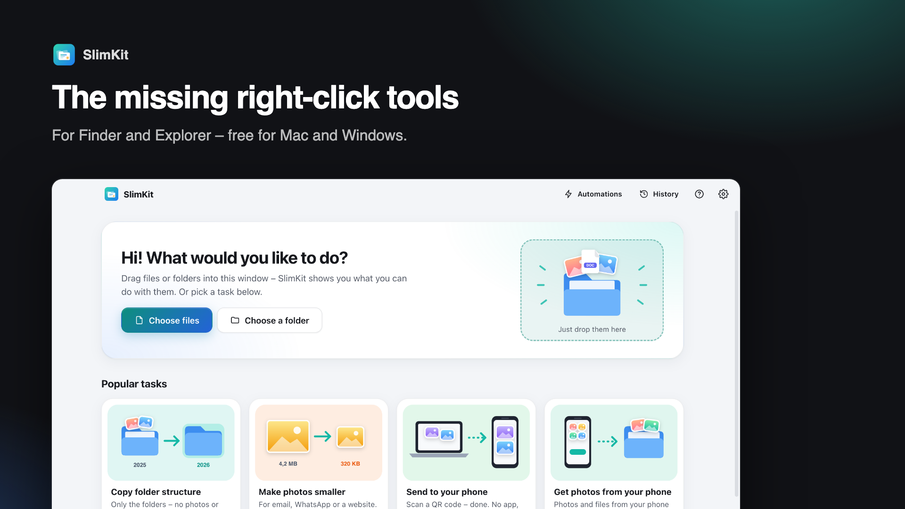

# SlimKit – the missing right-click tools for Finder & Explorer

**Select files, right-click, SlimKit: copy a folder structure without the files, batch rename, resize images, fix dates, send files to your phone with a QR code – and undo everything.**
Free · no ads · no account · no internet needed · Windows & Mac.

⬇️ **[Download SlimKit](https://slimbitapps.github.io/SlimKit/)** · by [SlimBit Apps](https://slimbitapps.github.io/)



## Why SlimKit?

- **Copy only the folder structure** – “Photos 2025” with all its subfolders becomes “Photos 2026”, without a single photo. The year is replaced automatically (also “School year 2025-2026” → “2026-2027”).
- **Every year automatically** – SlimKit continues your folder structure on 1 January by itself.
- **Right in the right-click menu** – Finder Quick Actions on the Mac, a “SlimKit” submenu and “Send to” on Windows. Set up with one click, no admin rights.
- **Send to your phone and back – no app** – scan a QR code, download files (or all as ZIP) or upload photos straight into a folder. Works with any iPhone or Android, only in your own Wi-Fi.
- **Batch rename** with live preview, **resize images by purpose** (email, WhatsApp, forms …) (target size in KB, removes location data), **set dates** from EXIF/video or from the file name, **combine images and PDFs**, **sort into folders by month or type**, **find duplicates**, **remove empty folders**, **see what takes up space**, **export file lists**, checksums …
- **Undo** – every change is in the history and can be undone with one click.
- Simple mode for everyone, expert mode with every option · English & German · light & dark.

## Install

- **Windows 10/11:** download `SlimKit-Setup.exe` and double-click it. No admin rights? Use `SlimKit-Windows-portable.zip`.
- **Mac (macOS 12+):** open `SlimKit-Mac.dmg` (Intel: `SlimKit-Mac-Intel.dmg`) and drag SlimKit into Applications.

---

# SlimKit (Deutsch)

Die fehlenden Rechtsklick-Werkzeuge für Finder (Mac) und Explorer (Windows). Kostenlos, ohne Werbung, ohne Konto.

**Alles bleibt lokal.** Keine Datensammlung, kein Internet nötig.

## Installieren

**Am einfachsten über die [Download-Seite](https://slimbitapps.github.io/SlimKit/)**: Sie erkennt dein System und erklärt die Installation.

- **Windows:** `SlimKit-Setup.exe` doppelklicken. Beim ersten Senden/Empfangen fragt die Firewall → **„Zugriff zulassen“**.
- **Mac:** `SlimKit-Mac.dmg` öffnen, Symbol auf „Programme“ ziehen.

## So funktioniert's

Beim ersten Start: **Sprache**, **Aussehen**, **Bedienung** (Einfach/Experte), **Rechtsklick-Menü einrichten** (ein Klick), kurze Einführung.

1. Im Finder/Explorer **Dateien oder Ordner markieren**.
2. **Rechtsklick → SlimKit** (Mac: „Schnellaktionen“, Windows 11: „Weitere Optionen anzeigen“).
3. Das passende Werkzeug öffnet sich mit deiner Auswahl – **Vorschau prüfen, Knopf drücken**. Fertig, und jederzeit rückgängig.

| Werkzeug | Was es macht |
|---|---|
| Ordnerstruktur kopieren | Nur die Ordner, ohne Dateien. Jahreszahl wird ersetzt, Vorlagen-Dateien optional mit, ergänzt vorhandene Ordner |
| Mehrere umbenennen | Durchnummerieren, Text ersetzen, Datum voranstellen, Schreibweise, eigene Vorlage mit Platzhaltern |
| Bilder verkleinern | 1280/1920/2560/4K, Prozent, Zielgröße in KB, JPG/PNG/WebP, HEIC → JPG (Mac), entfernt Standortdaten |
| Datum ändern | Aufnahmedatum (Foto-EXIF, Video), aus dem Dateinamen, festes Datum, verschieben (falsche Kamera-Uhr) |
| Aufs Handy senden | QR-Code → Webseite am Handy → einzeln oder alles als ZIP laden |
| Vom Handy empfangen | QR-Code → Fotos/Dateien am Handy auswählen → landen im gewählten Ordner |
| PDF zusammenfügen | Bilder und PDFs zu einer PDF (A4 oder Bildgröße), PDF in Seiten aufteilen |
| In Ordner sortieren | Nach Monat, Jahr, Tag, Dateityp oder Endung |
| Experte: | Doppelte Dateien, Ordner auflösen, leere Ordner, Ordnergröße, Dateiliste (CSV/Text), Prüfsumme, neue Textdatei, neuer Ordner mit Auswahl, Pfad kopieren |
| Automatik | Neues Jahr (Struktur fortführen), Ordner aufräumen (z. B. Downloads), alte Dateien in den Papierkorb |

## Sicherheit beim Übertragen

- Der QR-Code enthält einen **geheimen Zufallscode** – nur wer ihn sieht, kommt rein. Ein neuer QR-Code macht den alten ungültig.
- Nur Geräte aus dem **lokalen Netz**, nur IP-Adressen als Host (Schutz vor DNS-Rebinding), Sperre nach Fehlversuchen.
- Hochgeladene Dateien landen **nur** im gewählten Ordner, nichts wird überschrieben. Nach 30 Minuten Pause endet die Verbindung.

---

## Stand der Entwicklung

**Version 1.0** – 17 Werkzeuge, Rechtsklick-Menü (Mac + Windows), Übertragung per QR-Code, Automatik, Verlauf mit Rückgängig,
Vorlagen, Einfach/Experte, Deutsch/Englisch, hell/dunkel. Pläne: [docs/PLAN.md](docs/PLAN.md).

Veröffentlichen & bekannt machen: [docs/VEROEFFENTLICHEN.md](docs/VEROEFFENTLICHEN.md) · Texte für Portale: [docs/STORE-TEXTE.md](docs/STORE-TEXTE.md)

---

## Für Entwickler

Technik: Electron (Fenster, Dateien, Server), React + TypeScript (Oberfläche), Vite (Bauen), pdf-lib (PDF).
Die Handy-Seite ist bewusst ohne Framework (lädt sofort).

```bash
npm install
npm start            # App bauen und starten
npm test             # Logik- und Servertests
npm run test:e2e     # echte App automatisch durchklicken (inkl. Handy-Fenster, Screenshots)
npm run icons        # Logo und Symbole neu erzeugen
bash scripts/test-build.sh   # Testversion: Mac-DMG + Windows-ZIP in test-build/
```

Aufbau:
- `electron/core/` – Logik ohne Oberfläche: Ordnerstruktur, Umbenennen, Datum (EXIF/Video), Aufräumen, PDF, ZIP,
  Übertragungs-Server, Rechtsklick-Menü (Registry/Schnellaktionen), Automatik, Verlauf
- `electron/main.cjs` – Fenster, Start per Rechtsklick (`--action=…`), Menüleisten-Symbol, Verbindung zur Oberfläche
- `src/` – Oberfläche (React), Werkzeuge in `src/tools/`, Texte in `src/locales/`, Bildbearbeitung in `src/lib/image.ts`
- `src/phone/` – Handy-Seite · `test/` – automatische Tests · `brand/` – Logo · `website/` – Download-Seite

Installer werden per GitHub Actions automatisch gebaut (`.github/workflows/build.yml`) – nur bei Code-Änderungen,
nicht bei Texten, Bildern oder der Website.
